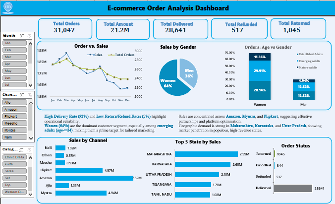
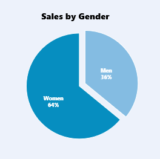
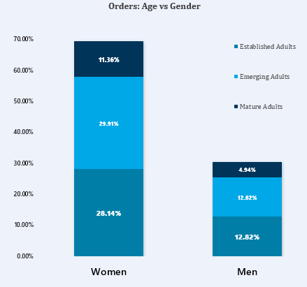
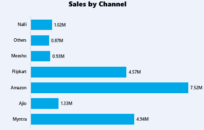
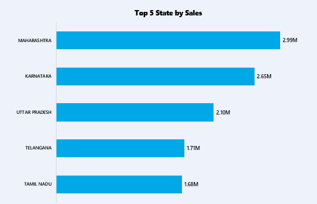

### 🛒 **E-commerce Order Analysis**

**Industry**: E-commerce
**Tools**: Microsoft Excel
---

### 🚀 **Executive Summary**

**Problem**:
The e-commerce business faced inconsistent sales growth despite an increase in website traffic. It was unclear which channels, regions, and customer segments were contributing the most to sales.

**Action**:
Analyzed 31,047 sales records and customer data using Microsoft Excel, creating a comprehensive dashboard that highlights key metrics such as sales trends, customer demographics, regional performance, and operational efficiency.

**Result**:
Key insights were derived showing that **64% of the orders come from women**, **Emerging Adults (18–34)** are the dominant customer segment, and **Maharashtra** and **Karnataka** are top-performing regions. With **92% successful deliveries**, the business is operating at a high efficiency level.

---

### 🎯 **Problem Statement**

**Core Issue**:
Despite consistent traffic growth, the business was unable to determine why sales were fluctuating in some regions and channels, with particular difficulty in identifying high-performing customer segments.

**Key Questions**:

* What are the key demographic trends in terms of customer gender and age?
* Which sales channels are driving the most revenue?
* How do sales differ across states, and which regions are the strongest performers?

---

### 📈 **Objectives & Key Metrics**

| **Objective**                     | **Metric Tracked**    | **Result Achieved**                                                          |
| --------------------------------- | --------------------- | ---------------------------------------------------------------------------- |
| Identify high-performing channels | Sales by Channel      | Flipkart and Amazon contribute over 60% of total sales.                      |
| Optimize regional sales focus     | Sales by State        | Maharashtra and Karnataka lead in sales volume.                              |
| Enhance customer targeting        | Customer Demographics | Women account for 64% of total orders; Emerging Adults lead in order volume. |

---

### 📂 **Data Overview**

**Data Sources**:

* E-commerce order data, including customer demographics, sales transactions, and order status.

**Key Variables**:

* **Amount**: Total sales value (USD)
* **Qty**: Order quantity
* **Gender**: Customer gender (Men/Women)
* **Age Group**: Segmentation of customers by age (Youth, Emerging Adults, Established Adults, Mature Adults)
* **Region**: Geographic sales distribution (State-wise)

**Data Challenges**:

* Standardization of gender data and age categorization for more accurate segmentation.

---

### 🔧 **Methodology**

* **Data Cleaning**:

  * Standardized gender and age data for clearer segmentation.
  * Addressed missing values and corrected outliers in the sales and order data.

* **Analysis Techniques**:

  * Used pivot tables for monthly aggregation of sales and order quantities.
  * Applied line charts and pie charts to visualize trends and customer distribution.

* **Tools**:

  * Microsoft Excel for data analysis, charts, and dashboard creation.

---

### 💡 **Key Insights**

1. **Women Drive Majority of Sales**

   * **What**: Women contribute **64%** of total orders.
   * **So What**: Women represent a primary customer demographic, and marketing efforts tailored to women are the clearest lever this data supports — the size of the lift is not measurable here, because the dataset contains no campaign data.

     
    
     **Figure 1: Gender Distribution of Orders**

2. **Emerging Adults Lead in Orders**

   * **What**: **Emerging Adults (18–34)** represent **40%** of total orders.
   * **So What**: This age group is key for continued growth. Tailored promotions or loyalty programs aimed at this demographic are the obvious next lever; the dataset cannot size the lift.

      

      **Figure 2: Orders by Age Group**

3. **Sales Channels Performance**

   * **What**: Flipkart and Amazon contribute over **60%** of total sales.
   * **So What**: Focusing on strengthening partnerships with these platforms can boost sales. Additional investments in marketing these channels could lead to further growth.

      

     **Figure 3: Sales by Channel**

4. **Regional Insights**

   * **What**: Maharashtra and Karnataka lead in sales.
   * **So What**: These regions should be prioritized for further investment, including regional promotions, stock allocation, and targeted campaigns.
   * **Figure 4: Sales by State**

     

---

### ✅ **Recommendations & Business Impact**

> **Impact figures below are illustrative targets, not measured outcomes.** This dataset contains no campaign, spend or post-campaign data, so the percentages size an opportunity — they do not forecast a result.

1. **Focus on Women-Centric Marketing Campaigns**

   * **Expected impact (illustrative)**: roughly 10% lift in female engagement — a target, not a measured result.
   * **Owner**: Marketing Team.
     Targeting women through specialized marketing strategies could significantly boost engagement, capitalizing on the 64% order share from female customers.

2. **Target Emerging Adults with Tailored Offers**

   * **Expected impact (illustrative)**: roughly 15% more orders from Emerging Adults — a target, not a measured result.
   * **Owner**: Marketing Team.
     Given that Emerging Adults (ages 18–34) are the largest customer segment, implementing tailored promotions and loyalty programs could lead to a substantial increase in order volume from this group.

3. **Strengthen Presence on Flipkart and Amazon**

   * **Expected impact (illustrative)**: roughly 12% sales lift from the two marketplaces — a target, not a measured result.
   * **Owner**: Sales Team.
     As Flipkart and Amazon together contribute over 60% of total sales, reinforcing partnerships with these platforms through enhanced marketing efforts could further grow revenue.

4. **Expand Regional Promotions in Maharashtra and Karnataka**

   * **Expected impact (illustrative)**: roughly 8% regional sales lift — a target, not a measured result.
   * **Owner**: Regional Managers.
     Maharashtra and Karnataka are the top-performing regions. Regional promotions, adjusted inventory, and localized marketing could lead to significant sales growth in these areas.

---

### 📉 **Caveats & Next Steps**

**Limitations**:

* The dataset lacked real-time updates on inventory and delivery statuses, which could affect decision-making around stock levels and order fulfillment.

**Next Steps**:

* **Integrate live data feeds** to enable dynamic reporting and provide real-time insights.
* **A/B test marketing campaigns** targeting Emerging Adults and women, focusing on promotional strategies and loyalty programs.
* **Monitor regional sales performance** continuously to adjust inventory and marketing spend in key states.

---

### 👤 Author

**Analyst:** Patrick Gichuki
**GitHub:** [BIAnalyst-Patrick](https://github.com/BIAnalyst-Patrick)
**LinkedIn:** [https://www.linkedin.com/in/patrick-gichuki-the-bi-analyst](https://www.linkedin.com/in/patrick-gichuki-the-bi-analyst)
